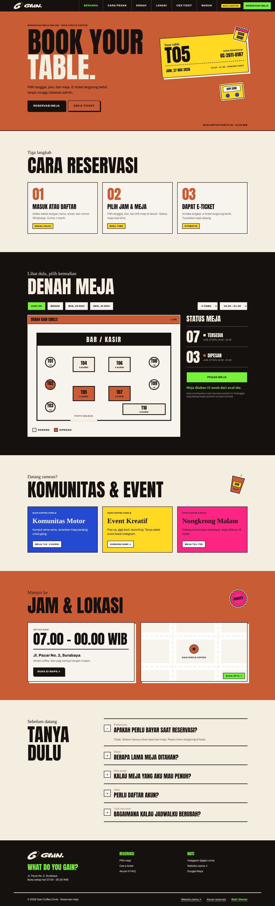
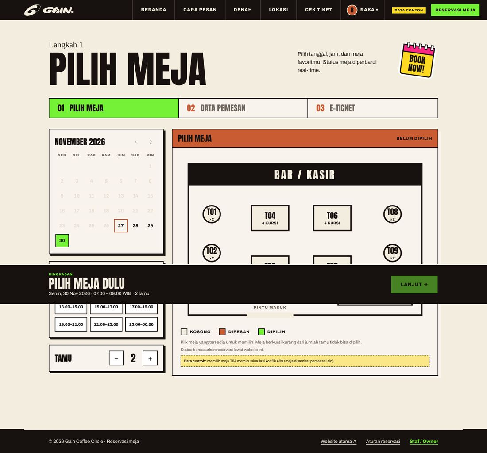
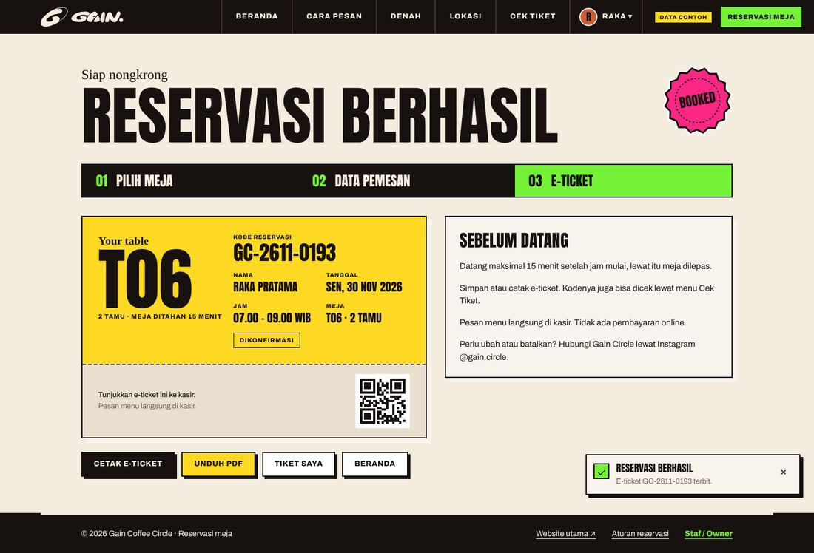
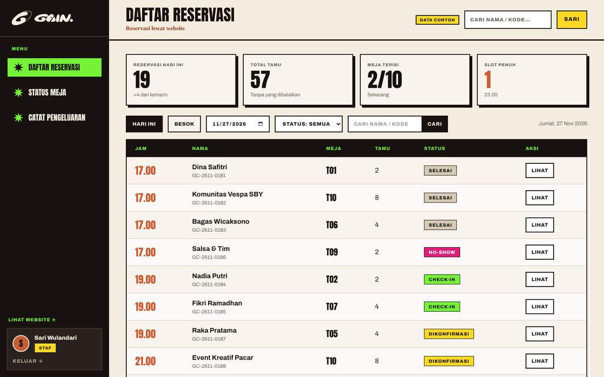
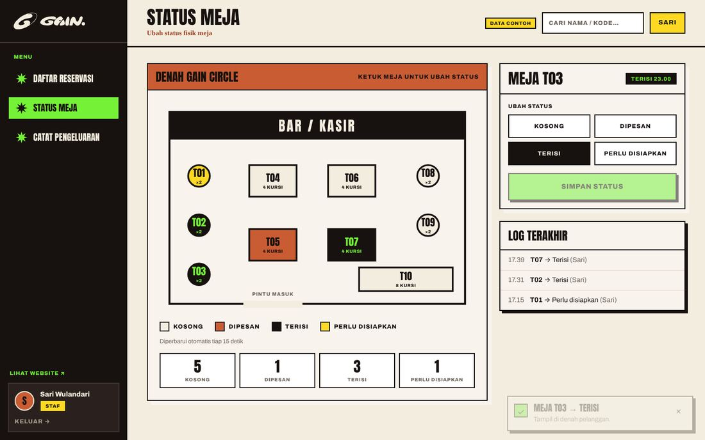
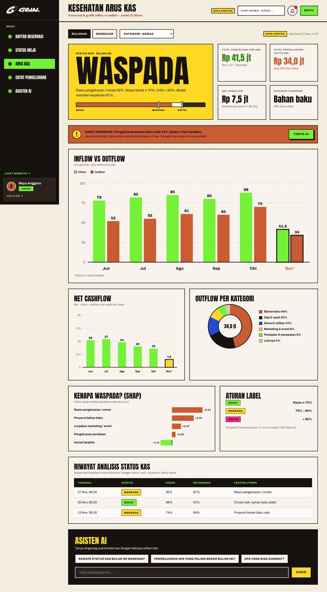
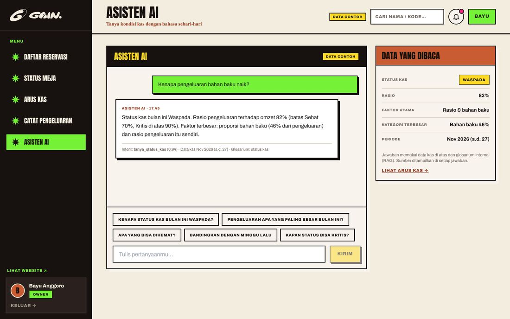
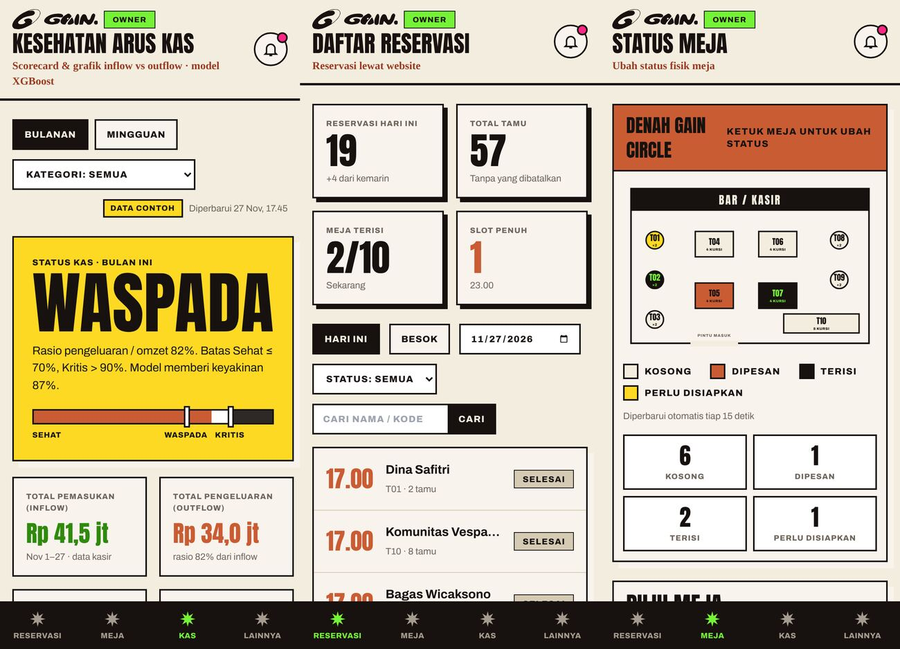

# Gain Circle · Frontend Reservasi Meja & Dashboard Arus Kas

Frontend web untuk **Gain Circle Coffee** (Jl. Pacar No. 2, Surabaya), Capstone A26-CS264.
Dua sisi dalam satu aplikasi React:

- **Pelanggan:** beranda, masuk/daftar + OTP, pilih meja di denah, e-ticket (QR, cetak, PDF), tiket saya, cek tiket.
- **Staf & Owner:** daftar reservasi, status meja, catat pengeluaran/pemasukan, impor sales, kesehatan arus kas, asisten AI (owner).

Seluruh 31 layar dari desain Figma tim sudah diimplementasikan, ditambah state sistem (loading, kosong, error, sesi berakhir, offline, 403/404).



## Stack

React 18 · Vite 8 · Tailwind CSS 3 · React Router 7 · react-hook-form + zod 4 (form dan validasi) · Axios (satu klien) ·
MSW (backend tiruan untuk dev/demo/tes) · Vitest + Testing Library · Playwright · grafik SVG buatan sendiri.

## Mulai cepat

```bash
npm install
cp .env.example .env.local      # untuk demo tanpa backend: set VITE_USE_MOCKS=true
npm run dev                     # http://localhost:5173
```

Butuh Node 20.19+ atau 22.12+ (diuji di Node 22; lihat `.nvmrc` di akar repo).

> **Mode contoh (`VITE_USE_MOCKS=true`)** menjalankan backend tiruan lewat service worker MSW di dalam browser, jadi semua alur
> bisa dicoba tanpa server. Semua data fiktif dan setiap halaman menampilkan lencana **DATA CONTOH**. Data kembali ke kondisi
> awal saat halaman di-reload.

### Akun demo (hanya mode contoh)

| Peran | Pintu masuk | Email | Kata sandi |
|---|---|---|---|
| Pelanggan | `/masuk` | `raka@email.com` | `password123` |
| Staf | `/staf/masuk` | `staf@gaincircle.id` | `staf12345` |
| Owner | `/staf/masuk` | `owner@gaincircle.id` | `owner12345` |

Kode OTP demo: **`482913`** (juga ditampilkan di layar OTP pada mode contoh).
Kredensial ini fiktif, hanya ada di `src/mocks/`, dan **tidak ikut bundel JavaScript build produksi** (cabang mock dibuang saat `VITE_USE_MOCKS` bukan `true`). Berkas `public/mockServiceWorker.js` (bawaan MSW, tanpa data) memang ikut tersaji, tetapi tidak pernah didaftarkan bila mode contoh mati.

Beberapa perilaku yang sengaja bisa dipicu di mode contoh:

- Memilih meja **T04** lalu konfirmasi memicu simulasi **409** (meja disambar pemesan lain).
- Pertanyaan "Bandingkan dengan minggu lalu" ke asisten gagal sekali (kuota AI) lalu pulih saat "Coba lagi".
- 5 kali salah di Cek Tiket memicu **429** dengan hitung mundur.
- Menambah pengeluaran besar mengubah rasio dan status kas (Sehat/Waspada/Kritis) secara nyata.

## Skrip

| Perintah | Fungsi |
|---|---|
| `npm run dev` | Server pengembangan |
| `npm run build` / `npm run preview` | Build produksi / pratinjau |
| `npm run lint` | ESLint, nol peringatan diizinkan |
| `npm test` | Vitest: unit, skema form, komponen, dan backend tiruan lewat MSW (45 tes) |
| `npm run test:e2e` | Playwright: 5 skenario kritis di desktop dan ponsel (butuh `npx playwright install chromium`) |

## Konfigurasi (`.env`)

Semua variabel `VITE_*` bersifat **publik**. Jangan menaruh rahasia di sini. Lihat `.env.example`.

| Variabel | Fungsi |
|---|---|
| `VITE_API_BASE_URL` | Alamat dasar API, mis. `https://api.example.com/api/v1` |
| `VITE_USE_MOCKS` | `true` = backend tiruan (dev/demo). Produksi: `false` |
| `VITE_MAIN_SITE_URL`, `VITE_INSTAGRAM_URL`, `VITE_MAPS_URL` | Tautan eksternal di footer/lokasi |

## Struktur

```
src/
  app/          router, layout (publik & dashboard), AuthContext, guard peran, modal sesi berakhir
  pages/        satu berkas per layar (pages/dashboard/* untuk staf & owner)
  features/     reservation (denah, kalender, slot, tiket, QR, PDF), cashflow (grafik SVG), auth (OTP)
  components/   ui/ (Button, Fields, Feedback: Toast/Modal/Drawer/Skeleton/Empty/Error), brand/ (logo, stiker)
  lib/          apiClient (satu-satunya Axios), api (layanan per modul), schemas (zod, semua form), format (WIB, rupiah),
                validators (helper murni), slots (aturan jam), errors, hooks, constants (token domain)
  mocks/        backend tiruan stateful: server.js (logika), handlers.js (MSW), browser.js/node.js (hanya dimuat saat mock aktif/tes)
  styles/       Tailwind + token desain
e2e/            tes Playwright
docs/           kontrak API, catatan desain, laporan QA, tangkapan layar
```

### Peta layar ke rute

| Layar | Rute | Akses |
|---|---|---|
| Beranda | `/` | publik |
| Masuk · Daftar · Verifikasi OTP | `/masuk` · `/daftar` · `/verifikasi-otp` | tamu |
| Reservasi: Pilih meja → Data pemesan → E-ticket | `/reservasi` → `/reservasi/data` → `/reservasi/tiket/:kode` | pelanggan |
| Tiket saya | `/tiket-saya` | pelanggan |
| Cek tiket (tanpa akun) | `/cek-tiket` | publik |
| Masuk dashboard · OTP staf | `/staf/masuk` · `/staf/verifikasi` | tamu |
| Daftar reservasi + detail (drawer) | `/dashboard/reservasi[/:kode]` | staf, owner |
| Status meja | `/dashboard/meja` | staf, owner |
| Catat pengeluaran · pemasukan · impor sales | `/dashboard/pengeluaran` · `/pemasukan` · `/pemasukan/impor` | staf, owner |
| Arus kas · Asisten AI | `/dashboard/kas` · `/dashboard/asisten` | **owner** |
| 403 · 404 · sesi berakhir · offline | `/akses-ditolak` · `*` · modal global · banner | sesuai kasus |
| Style guide | `/dev/style-guide` | hanya build dev |

Versi ponsel (390 px) adalah tampilan responsif dari rute yang sama (tab bawah untuk dashboard, tabel menjadi kartu).

## Menyambungkan backend asli

1. Isi `VITE_API_BASE_URL`, set `VITE_USE_MOCKS=false`.
2. Backend mengikuti [`../docs/KONTRAK_API.md`](../docs/KONTRAK_API.md): respons seragam `{ success, data, error }`, JWT Bearer.
3. Semua panggilan lewat `src/lib/api.js`. Jika bentuk respons backend berbeda, ubah di sana, bukan di komponen.
4. Aktifkan CORS untuk origin frontend di backend.

Deploy ke Vercel: `vercel.json` sudah berisi rewrite SPA dan header keamanan dasar.

## Keamanan

- Token sesi disimpan di `sessionStorage` karena backend belum memakai cookie `httpOnly`. Risikonya XSS membaca token. Bila backend menyediakan refresh cookie `httpOnly`, ganti `src/lib/session.js`.
- Peran di sisi klien (guard rute) hanya untuk pengalaman pengguna. **Otorisasi sebenarnya wajib di server.**
- Parameter `?next=` divalidasi (`safeNext`) agar tidak menjadi open redirect, termasuk varian backslash.
- Tidak memakai `dangerouslySetInnerHTML`. QR dirender sebagai elemen SVG.
- Dependensi diperiksa dengan `npm audit` (hasil terakhir: 0 kerentanan, termasuk dependensi dev). Jalankan ulang secara berkala.

## Aksesibilitas

Skip link, fokus terlihat, label terhubung ke input, galat dibacakan (`role="alert"`), modal dengan fokus terjebak dan Escape, denah bisa dipakai dengan keyboard, grafik punya tabel alternatif untuk pembaca layar, dan `prefers-reduced-motion` dihormati. Audit otomatis axe-core (WCAG 2.0 A/AA) pada 10 halaman: 0 pelanggaran. Pengujian manual dengan pembaca layar belum dilakukan.

## Catatan untuk yang melanjutkan

- Mulailah membaca dari `src/lib/api.js` (semua pemanggilan API), `src/app/router.jsx` (peta rute dan guard peran), dan `src/pages/Reservasi.jsx` (alur reservasi).
- Aturan domain yang masih menunggu persetujuan owner (ambang 70%/90%, durasi 2 jam, kebijakan batal/no-show, walk-in) ada di [`docs/CATATAN_DESAIN.md`](docs/CATATAN_DESAIN.md). Nilainya terpusat di `src/lib/constants.js`.
- Logo dan stiker adalah hasil penelusuran/SVG sederhana. Ganti dengan aset resmi bila tersedia.
- Detail verifikasi dan batasannya: [`docs/QA.md`](docs/QA.md).

## Tangkapan layar

| Pilih meja | E-ticket |
|---|---|
|  |  |
| **Daftar reservasi (staf)** | **Status meja (staf)** |
|  |  |
| **Arus kas (owner)** | **Asisten AI (owner)** |
|  |  |


